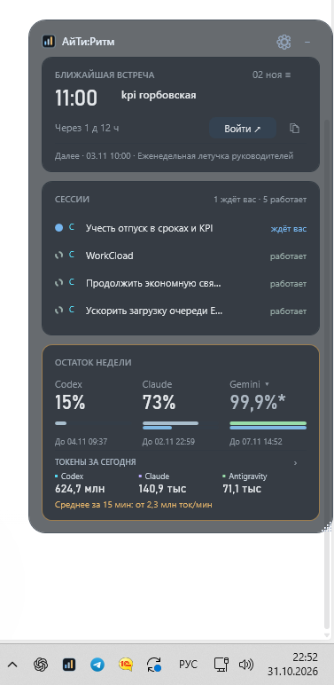

# AITI Rhythm — AI session monitor for Windows

[Русский](README.md) · [Download for Windows](https://github.com/mssafonov-cmyk/aiti-rhythm/releases/latest) · [Report an issue](https://github.com/mssafonov-cmyk/aiti-rhythm/issues)

**See which agent is working, which one needs your reply, and how much subscription quota remains.**

AITI Rhythm is a small Windows desktop widget for **Codex, Claude Code and Antigravity CLI**.
When you run several AI coding sessions at once, it keeps their status in view
so you can spot a waiting agent without checking every chat and terminal.

*Actual screenshot. The interface is currently in Russian; values reflect the sources at capture time.*

## What it shows

- **Agent activity:** sessions that are working or waiting for a reply, with links back to supported clients.
- **Token usage:** daily totals, recent consumption rate and an alert identifying the busiest session.
- **Subscription limits:** weekly and five-hour quota windows and reset times, when available from the source.
- **Meetings:** the next calendar event and a join button, if you connect a calendar.

The panel can shrink to 260 pixels, hide individual sections and stay in the system tray.
Calendar connections and the optional GeekMagic display are disabled by default.

## Install

1. Download `AITI-Rhythm-…-Setup.exe` from the [latest release](https://github.com/mssafonov-cmyk/aiti-rhythm/releases/latest).
2. Run the installer on Windows 10 (1809+) or Windows 11, x64. No separate Python installation or administrator access is needed.
3. Launch **АйТи Ритм**. It looks for your existing Codex, Claude Code and Antigravity session logs. Sign in through those tools as usual.

Use the gear button to configure sources and choose visible sections.
To update, run the new installer over the existing installation; connection settings are retained.

## Understanding the numbers

Token totals are usage counters, not a bill or the percentage of a subscription.
Different tools may account for cached tokens differently. Daily totals use Moscow time (UTC+3).

Quota availability depends on the source and account. Local Claude may not expose quota data.
Antigravity quota capture is opt-in and updates from its running CLI; Gemini and other models have separate limits.

During an outage, the last known daily token total and Claude quota remain available with
their original timestamp and an asterisk. Historical quota is marked as such; a completed
quota window is not treated as a confirmed current allowance. Retry-After pauses survive restarts.

The app reads usage metadata and does not submit model prompts to obtain these counters.
Personal settings are kept outside the program directory; connection secrets use Windows DPAPI.

## Project

Created by **Maxim Safonov** ([mssafonov-cmyk](https://github.com/mssafonov-cmyk)). MIT license.

[Connection guide](PACKAGE-README.txt) · [Privacy and security](SECURITY.md) · [Build instructions](CONTRIBUTING.md)

The guides above are currently in Russian. Source code and Windows installers are published in this repository.
