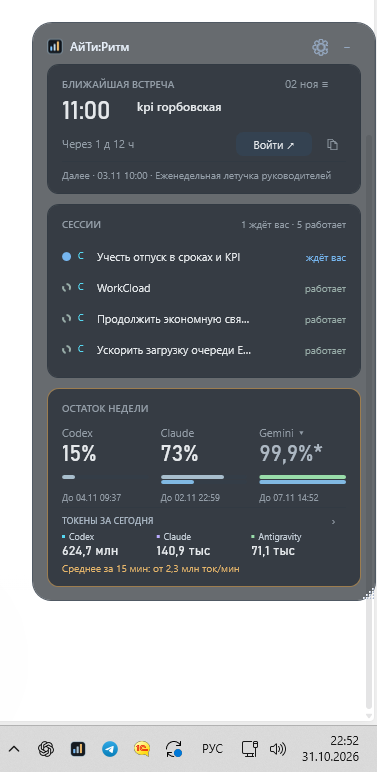

# АйТи:Ритм (AITI Rhythm)

[English](https://github.com/mssafonov-cmyk/aiti-rhythm/blob/main/README.en.md) · [Скачать для Windows](https://github.com/mssafonov-cmyk/aiti-rhythm/releases/latest) · [Сообщить о проблеме](https://github.com/mssafonov-cmyk/aiti-rhythm/issues)

**Кто из ИИ-агентов работает, кто ждёт ответа и сколько осталось лимита — в одном небольшом окне.**

Ритм — настольная панель для **Codex, Claude Code и Antigravity CLI**.
Она пригодится, когда ведёшь несколько сессий одновременно: не нужно по очереди
открывать каждый чат или терминал, чтобы проверить, где требуется твоё участие.

Windows desktop widget and AI session monitor: token usage, subscription limits
and agent activity for Codex, Claude Code and Antigravity.

*Реальный скрин панели. Значения показывают состояние источников в момент снимка.*

## Зачем нужен Ритм

- **Не пропускать ожидание ответа.** Видно, какая сессия работает, а какая ждёт тебя; из панели можно перейти к сессии.
- **Следить за расходом.** Нажмите плашку Codex, Claude или Antigravity: отдельный график токенов по дням и итог за последние 7 дней, 30 дней или всю доступную историю. Дневные токены, скорость расхода и предупреждение с указанием наиболее затратной сессии.
- **Сравнивать инструменты.** Лимиты и дневной расход объединены в трёх карточках. В истории есть чипсы инструментов и «Всего», сравнительные полосы и общий график. График скорости и лидер расхода под карточками можно свернуть.
- **Переключать аккаунт Codex.** Список сессий показывает подтверждённые сессии текущего аккаунта, квота обновляется при смене входа. Исторические токены Codex остаются статистикой всего локального профиля, с явной подписью: метаданные владельца чата не позволяют достоверно определить оплативший аккаунт каждого хода.
- **Запускать вместе с Windows.** Настройки → «Вид панели» → «Запускать при входе в Windows». Работает для текущего пользователя без администратора.
- **Видеть доступные квоты.** Недельный и пятичасовой остаток, время сброса; последнее известное значение сохраняется с отметкой времени при сбое источника.
- **Держать встречу перед глазами.** Ближайшее событие и кнопка входа, если подключён календарь.

Панель работает в Windows 10/11, сворачивается в трей и сужается до 260 пикселей.
Календарь и физический кубик подключаются по желанию. Установка — обычным Setup.exe.

## Установить

1. [Скачайте Setup.exe из Releases](https://github.com/mssafonov-cmyk/aiti-rhythm/releases/latest).
2. Откройте установщик. Python, команды и права администратора не нужны.
3. Запустите «АйТи Ритм». Панель найдет журналы ваших Codex, Claude Code и Antigravity;
   если вы еще не входили в них, сначала войдите и запустите первую сессию.

Подключения — под шестерёнкой. Календарь и кубик выключены по умолчанию:
можно пользоваться панелью без них. Автозапуск выбирается при установке.
Для обновления запустите новый Setup.exe поверх — личные настройки сохранятся.

Во вкладке **«Вид»** можно скрыть календарь, сессии, лимиты или расход и подобрать
высоту окна автоматически. Подключения при скрытии сохраняются. В лимитах рядом
показан недельный остаток. Пятичасовой лимит — тонкая полоса под ним, только если
его передал источник. Период и сброс — в подсказке по наведению.

«Токены за сегодня» — отдельные итоги Codex, Claude и Antigravity по их сессиям.
Ниже — средняя скорость с указанным периодом. «От» означает, что скорость известна
не для всех источников. График и наиболее затратная сессия — по стрелке подробностей.
При сбое последнее дневное число сохраняется, в том числе после перезапуска.
Звёздочка означает сохранённый итог; время обновления — по наведению.
Последний известный процент Claude также сохраняется после сбоя и перезапуска:
`*` и дата под процентом показывают, когда он был получен. Это не подтверждение
текущего остатка; в подсказке отдельно отмечено завершившееся окно лимита.
При ограничении частоты запросов (429) Ритм соблюдает указанную сервисом паузу,
в том числе после перезапуска. Токены в это время продолжают собираться.
Antigravity не занимает место, если не найдена. Для её лимитов включите
«Передавать остаток лимитов в Ритм» во вкладке AGY и откройте свою консоль `agy`.
Gemini показан рядом с Codex и Claude с таким же процентом. По названию Gemini
переключаются другие модели Antigravity; сброс — по наведению.
Ритм сохраняет прежнюю строку состояния и восстанавливает её при отключении.

## Или попросить Codex / Claude

Скопируйте этот текст в своего помощника:

> Установи АйТи:Ритм из официального репозитория
> https://github.com/mssafonov-cmyk/aiti-rhythm.
> Найди последний опубликованный Windows-релиз, скачай Setup.exe и SHA256SUMS.txt,
> проверь SHA256 и установи для текущего пользователя без повышения прав.
> Python отдельно не устанавливай, входы Codex, Claude и Antigravity не меняй.
> Календарь, кубик и автозапуск оставь выключенными.
> Проверь запуск и обнаружение моих инструментов. Предупреждения Windows не обходи.
> Если опубликованного установщика еще нет или хеш не совпал — остановись и сообщи.

## Дополнительно

- **Календарь:** личная iCal-ссылка Яндекса/Google, CalDAV или настроенный OData.
  Только просмотр и напоминания, без изменения встреч.
- **Кубик:** HelloCubic-Lite / SmallTV-Ultra, свой адрес в локальной сети.
  [Устройства GeekMagic](https://geekmagic.com/). Вывод выключен по умолчанию.
- **Свои источники:** можно указать другие папки, WSL или внешний JSON-сборщик.

Точная квота Codex зависит от его аккаунта. Для локального Claude квота подписки
может быть недоступна — расход токенов ее не заменяет. Antigravity читает локальные
журналы, а по вашему выбору — квоты, переданные её CLI; запросы к модели не запускает.
Квоты обновляются, пока открыта консоль `agy`; после 10 минут без обновления —
звёздочка, после сброса окна его старый остаток скрывается. История внешнего Claude может быть недоступна —
тогда его дневной итог есть в легенде, но линия не выдумывается. Счётчики
источников могут по-разному учитывать кэш и не означают стоимость. Дневные метрики — по МСК.

Подробности: [подключения](PACKAGE-README.txt), [личные данные](SECURITY.md),
[разработка и сборка](CONTRIBUTING.md). Код общий для всех установок. Лицензия — MIT.

Автор: **Максим Сафонов** ([mssafonov-cmyk](https://github.com/mssafonov-cmyk)).

Уведомление о повышенном расходе открывает указанную в нём сессию, даже если
лидер расхода уже сменился. Приложение выбирается по метке журнала: Codex Desktop,
VS Code, Cursor или Windsurf. Для Claude есть переход в VS Code. Если метки нет
или работа идёт в терминале, Ритм предлагает выбрать приложение или скопировать ID.
Новое задание агенту при переходе не отправляется.
